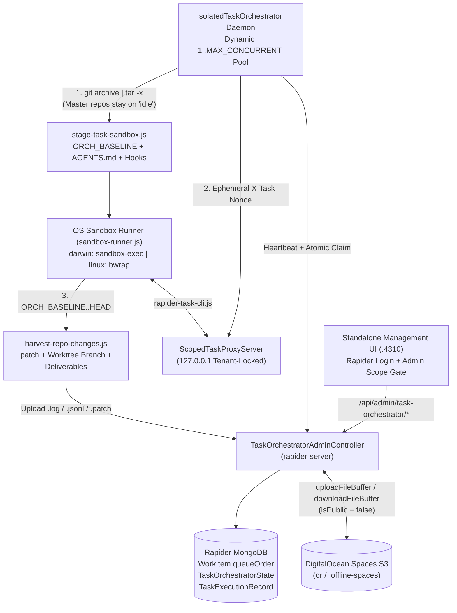

# Rapider Isolated Multi-Repo Task Orchestrator & Admin Management UI — Complete Guide

## 1. Executive Summary

The **Rapider Isolated Multi-Repo Task Orchestrator** (`scripts/isolated-task-orchestrator.js`) and **Standalone Admin Management & Monitoring UI** (`management-ui/`) execute queued Workspace Inbox tasks (`WorkItem` with `kind: "task"`) concurrently across local **macOS (`darwin`)** and production **Ubuntu Linux (`linux`)** worker nodes while guaranteeing **100% physical repository, history, and credential blindness**.

### Core Architectural Guarantees
1. **Live-Adjustable Concurrency (`MAX_CONCURRENT = 1..100`, Default `5`)**:
   - Stored in Rapider's primary MongoDB (`TaskOrchestratorState.maxConcurrent`) and adjustable live at runtime via the Admin Management UI or `npm run ctl:concurrency -- <N>` with zero worker restarts.
2. **Unified Rapider MongoDB Metadata + Private S3 Logs (`s3-file.service.ts`)**:
   - All queue ranks (`WorkItem.queueOrder`), orchestrator configuration/heartbeats/signals (`TaskOrchestratorState`), and run telemetry (`TaskExecutionRecord`) live directly inside **Rapider's existing MongoDB** (automatically switching to `rapider_offline` when `IS_OFFLINE_MODE=true`).
   - Full execution `.log` files, `agy` `stream-json` `.jsonl` trajectories, and harvested git `.patch` diffs are uploaded **privately (`isPublic = false`)** via `rapider-server/rappider/src/services/s3-file.service.ts` (DigitalOcean Spaces in online mode; `/_offline-spaces` on local disk in offline mode).
3. **Non-Destructive Multi-Repo Staging (`idle` Branch Preservation)**:
   - Persistent master repositories (`WORKSPACES/<projectId>`, `rapider-apps/APPS/<app>`, and `_repo-cache/*.git`) are **never deleted** and stay permanently parked on their orphan `idle` branch (`README.md` only).
   - For each claimed task, `stage-task-sandbox.js` extracts **only** that Workspace's context (`workspace-context/`) and its installed microapplications (`apps/<appKey>/`) via `git archive <baseSha> | tar -x`, initializing a fresh 1-commit local git repo tagged `ORCH_BASELINE` (**zero remotes, zero prior commit history, zero `idle` branch, zero sibling apps**).
4. **Kernel-Enforced OS Sandbox + Ephemeral Capability Proxy**:
   - **macOS (`darwin`)**: `/usr/bin/sandbox-exec` Seatbelt profile blocking `file-read*` / `file-write*` on sibling `_sandboxes/*`, `WORKSPACES/*`, `APPS/*`, `~/.ssh`, `~/.aws`, and all `.env` / `.server.env` files, while enforcing read-only access on `<sandbox>/tools/`.
   - **Ubuntu Linux (`linux`)**: Rootless `/usr/bin/bwrap` (Bubblewrap) namespace jail (`--unshare-pid --unshare-ipc --unshare-uts --die-with-parent`) bind-mounting only `/usr`, `/bin`, `/lib*`, `/tools` (read-only), and `/workspace` + `/output` (read-write).
   - **Scoped Loopback Capability Proxy (`scripts/scoped-task-proxy.js`)**: Issues a per-task cryptographic `X-Task-Nonce` on `127.0.0.1` immutably bound on the host to `workItem.projectId` and its authorized `ProjectModel` tables. `agy` never receives JWTs, API keys, DB URIs, or S3 secrets.
5. **Guaranteed 4-Layer Agent Rules, Skills & Lifecycle Hooks**:
   - Every sandbox receives `/workspace/AGENTS.md` (`< 12 KB`), `/workspace/TASK_BRIEF.md` (with an auto-discovered **Mounted Repo & Docs Index**), modular playbooks in `/workspace/.agents/skills/*/SKILL.md`, and `/workspace/.agents/hooks.json` (`SessionStart` checklist + `Stop` Confidentiality & Deliverable Gate).

---

## 2. End-to-End Architecture Flow



---

## 3. Complete `package.json` Scripts Reference (`rapider-task-worker`)

Run all commands below from `/Users/tanselozkusaksiz/Projects/Rappider/code/_rapider-monorepo/rapider-task-worker`:

### A. Orchestrator Daemon & Standalone Admin UI

| Script | Underlying Command | Description |
| :--- | :--- | :--- |
| `npm run orchestrator` | `node scripts/isolated-task-orchestrator.js` | Starts the continuous Isolated Multi-Repo Task Orchestrator daemon (`1..MAX_CONCURRENT` live pool). |
| `npm run orchestrator:once` | `node scripts/isolated-task-orchestrator.js --once` | Claims up to `MAX_CONCURRENT` queued tasks once, runs them to completion in isolated sandboxes, uploads logs/artifacts, and exits. |
| `npm run orchestrator:offline` | `node scripts/isolated-task-orchestrator.js --offline` | Runs continuous orchestrator using local cached Workspace snapshots without remote git/snapshot network sync. |
| `npm run orchestrator:once:offline` | `node scripts/isolated-task-orchestrator.js --once --offline` | Drains a single batch in offline snapshot mode and exits. |
| `npm run ui` | `node management-ui/server.js` | Starts the Standalone Admin Task Management & Monitoring Web UI on `http://localhost:4310` (100% offline-ready local Tailwind + FontAwesome). |

### B. Live Operator Control Plane CLI (`rapider-task-ctl.js`)

| Script | Example Usage | Description |
| :--- | :--- | :--- |
| `npm run ctl` | `npm run ctl -- --help` | Displays all `rapider-task-ctl.js` commands and options. |
| `npm run ctl:status` | `npm run ctl:status` | Prints global state (`RUNNING`/`PAUSED`), active slot count (`active/maxConcurrent`), online workers, active tasks, and **Next 20** queue. |
| `npm run ctl:history` | `npm run ctl:history` | Prints the **Last 20** completed, pending, failed, rejected, or cancelled tasks. |
| `npm run ctl:concurrency` | `npm run ctl:concurrency -- 10` | Live-updates `MAX_CONCURRENT` (`1..100`) in Rapider MongoDB; active workers scale immediately without restart. |
| `npm run ctl:pause` | `npm run ctl:pause` | Soft-pauses new task claims while allowing currently running tasks to finish cleanly. |
| `npm run ctl:hard-pause` | `npm run ctl:hard-pause` | Hard-stops claiming **and** dispatches `hard_pause_all` to terminate all active sandbox process groups (`-PGID`). |
| `npm run ctl:resume` | `npm run ctl:resume` | Clears soft/hard pause flags and resumes claiming from the queue. |
| `npm run ctl:pin-top` | `npm run ctl:pin-top -- <workItemId>` | Moves a queued task immediately to **Rank #1 (Top of Queue)** (`minQueueOrder - 1000`). |
| `npm run ctl:kill-task` | `npm run ctl:kill-task -- <workItemId>` | Immediately terminates a specific running task's sandbox PGID and marks it `failed`. |
| `npm run ctl:requeue-top` | `npm run ctl:requeue-top -- <workItemId>` | Re-queues any historical/failed/cancelled task at **Rank #1**. |
| `npm run ctl:logs` | `npm run ctl:logs -- <workItemId> --type=log` | Streams private S3 `.log`, `.jsonl` (`--type=jsonl`), git `.patch` (`--type=patch`), or live MongoDB tail (`--type=tail`). |
| `npm run ctl:cache-status` | `npm run ctl:cache-status` | Verifies all persistent master repos under `WORKSPACES/` are safely parked on their orphan `idle` branch. |

### C. Workspace Repo Management, Legacy Single-Worker & Tests

| Script | Underlying Command | Description |
| :--- | :--- | :--- |
| `npm test` | `node --test tests/*.test.js` | Runs all 11 unit, OS-sandbox (`sandbox-exec`), proxy, Stop-hook, and UI gateway tests. |
| `npm run test:orchestrator` | `node --test tests/isolated-orchestrator.test.js` | Runs only the Isolated Multi-Repo Orchestrator, OS jail blindness, and Management UI test suite. |
| `npm run status` | `node scripts/manage-workspace-repos.js --status` | Shows active vs `PARKED (idle)` branch status for all local `WORKSPACES/<projectId>` repos. |
| `npm run park:all` | `node scripts/manage-workspace-repos.js --park-all` | Forces every repo in `WORKSPACES/` onto its orphan `idle` branch. |
| `npm run activate` | `node scripts/manage-workspace-repos.js --activate=<projectId>` | Manually activates a single Workspace snapshot on `main` for inspection. |
| `npm run fetch-tasks` | `node scripts/fetch-and-validate-tasks.js --limit=5` | Diagnostic queue fetch ordered by `queueOrder ASC -> occurredAt ASC -> createdDate ASC`. |
| `npm run fetch-tasks:all` | `node scripts/fetch-and-validate-tasks.js --all` | Diagnostic listing of tasks across all statuses. |
| `npm run workspace:tools` | `node scripts/workspace-tools-cli.js` | Host-side CLI for Workspace model queries, Handlebars compile checks, CSV exports, and PDF rendering. |
| `npm run upload-artifact` | `node scripts/upload-task-artifacts.js` | Uploads generated deliverables to Workspace `ProjectFile` storage (`Task Outputs`). |
| `npm run patch-task` | `node scripts/patch-workitem-task.js` | Patches a `WorkItem` status/outcome and appends a sanitized `WorkItemEvent`. |
| `npm run logs:sync` | `node scripts/generate-iteration-logs.js` | Generates Markdown iteration summaries from daily execution ledgers. |
| `npm run worker` / `worker:once` | `node scripts/task-worker-daemon.js` | Legacy single-slot sequential task worker daemon. |
| `npm run ubuntu:setup` | `bash deploy/ubuntu-setup.sh` | Provisions Ubuntu 22.04/24.04 LTS (`bubblewrap`, AppArmor profile, Node 24, `rapider-worker` user). |

---

## 4. Sandbox Directory Layout & 4-Layer Agent Rules

For each claimed task (`workItem.id`), `stage-task-sandbox.js` constructs `_sandboxes/task-<id>-<runShort>/`:

```text
_sandboxes/task-<workItemId>-<runShort>/
├── seatbelt.sb                           # Generated macOS Seatbelt profile (darwin)
├── staging-manifest.json                 # Staged repo baseline SHAs & allowed table list
├── home/                                 # Isolated $HOME for sandboxed process
├── tmp/                                  # Isolated $TMPDIR
├── logs/
│   ├── execution.log                     # Human-readable timestamped log -> Private S3
│   ├── trajectory.jsonl                  # agy stream-json steps -> Private S3
│   └── patches/*.patch                   # git diff --binary ORCH_BASELINE..HEAD -> Private S3
├── tools/                                # Mounted READ-ONLY inside OS jail
│   ├── rapider-task-cli.js               # Zero-secret CLI talking to 127.0.0.1 ScopedTaskProxy
│   ├── node_modules/handlebars.js        # Self-contained Handlebars compiler bundle
│   └── hooks/
│       ├── on-session-start.js           # Injects mandatory startup & attachment checklist
│       └── on-stop-verify.js             # Blocks exit if task-outcome.json missing or leaks paths
├── output/                               # Read-write deliverable & outcome dropbox
│   ├── task-outcome.json                 # Structured completion JSON verified by Stop hook
│   └── deliverables/                     # .md, .csv, .pdf, .hbs uploaded to ProjectFiles
└── workspace/                            # agy CWD (--workspace)
    ├── AGENTS.md                         # Layer 1: Root Sandbox Rules (<12 KB, always loaded)
    ├── TASK_BRIEF.md                     # Exact prompt, replies, attachments & Mounted Docs Index
    ├── .task-attachments/                # Pre-downloaded ProjectFiles & S3 images
    ├── .agents/
    │   ├── hooks.json                    # Layer 4: SessionStart + Stop hooks
    │   └── skills/                       # Layer 3: On-demand modular playbooks
    │       ├── complex-data-reporting/SKILL.md
    │       ├── handlebars-templating/SKILL.md
    │       ├── deliverable-files/SKILL.md
    │       └── workspace-api-actions/SKILL.md
    ├── workspace-context/                # 1-commit ORCH_BASELINE snapshot of target Workspace ONLY
    │   ├── WORKSPACE_CONTEXT.md
    │   ├── models/*.model.json
    │   ├── schemas/data-schemas.json
    │   └── templates/*.json
    └── apps/                             # Layer 2: ONLY microapps installed in this Workspace
        └── <appKey>/                     # 1-commit ORCH_BASELINE repo (0 remotes, 0 history)
            ├── AGENTS.md                 # Hierarchical sub-repo rules auto-loaded by agy
            ├── README.md
            └── app.manifest.json
```

---

## 5. Standalone Admin Management & Monitoring UI (`management-ui/`)

- **URL**: `http://localhost:4310` (started via `npm run ui`, configurable via `MANAGEMENT_UI_PORT`).
- **Authentication & Authorization**:
  - Logs in against Rapider (`POST /api/users/login` -> `GET /api/users/people` -> `POST /api/users/change-active-person`) and verifies `GET /api/admin/task-orchestrator/me`.
  - Any user without `PermissionScope.Admin` (`"admin"` in `scope`) receives `403 Forbidden` on both the API and UI login screen.
- **Separated Two-Tab Console**:
  - **Tab 1 — `Active & Queue (Next 20)`**:
    - Live cards for currently **in-progress tasks** showing Workspace, worker node (`darwin` / `linux`), PID, staged repos, rolling `logTail` terminal, **`Logs`** button, and red **`Kill`** button.
    - **Next 20 Queued Tasks** table supporting **HTML5 Drag-and-Drop reordering**, **`#1` (Pin to Top)**, **`↑` / `↓`**, search filter with `#activeFilterTagsBar` + `Clear all`, and **`Cancel`**.
  - **Tab 2 — `Past History (Last 20)`**:
    - **Last 20** finished/attention tasks (`resolved`, `pending`, `failed`, `rejected`, `cancelled`) with duration, attached deliverable count, harvested `ai/task-...` git branch badges, **`S3 Logs`** slide-over viewer (`.log`, `.jsonl`, `.patch`, `tail`), and **`Re-queue #1`**.

---

## 6. Environment Configuration (`.env` — Never Hardcode Secrets)

Configure `rapider-task-worker/.env` (gitignored; see `.env.example`):

```ini
# Rapider Backend API URL (local offline/online server or remote server)
RAPIDER_BACKEND_URL=http://localhost:8081

# Admin Rapider Account used by the Worker Daemon to claim tasks & upload private S3 logs
RAPIDER_WORKER_EMAIL=your-admin-user@domain.com
RAPIDER_WORKER_PASSWORD=your-password

# Optional Orchestrator Defaults (live-overridden by MongoDB TaskOrchestratorState)
MAX_CONCURRENT=5
POLL_INTERVAL_SECONDS=10
SANDBOX_RETENTION_COUNT=20
TASK_TIMEOUT_MS=900000
MANAGEMENT_UI_PORT=4310
```

---

## 7. Local macOS Testing & Ubuntu Server Deployment

### Local macOS (Online or Offline)
1. Start `rapider-server` (`http://localhost:8081` — use `node scripts/run-offline.js` when offline so `rapider_offline` MongoDB and `/_offline-spaces` S3 storage are active).
2. In terminal 1: `cd rapider-task-worker && npm run orchestrator`
3. In terminal 2: `cd rapider-task-worker && npm run ui`
4. Open `http://localhost:4310`, sign in with your Rapider Admin user, adjust `MAX_CONCURRENT`, enqueue or reorder tasks, and inspect live logs.

### Ubuntu 22.04 / 24.04 LTS Production Server
1. Provision dependencies & `bwrap` AppArmor profile:
   ```bash
   cd /opt/rapider/rapider-task-worker
   npm run ubuntu:setup
   ```
2. Create `/opt/rapider/rapider-task-worker/.env` (`chmod 600`) with `RAPIDER_BACKEND_URL` and admin worker credentials.
3. Install and enable the `systemd` units:
   ```bash
   sudo cp deploy/rapider-task-orchestrator.service /etc/systemd/system/
   sudo cp deploy/rapider-task-management-ui.service /etc/systemd/system/
   sudo systemctl daemon-reload
   sudo systemctl enable --now rapider-task-orchestrator rapider-task-management-ui
   ```

