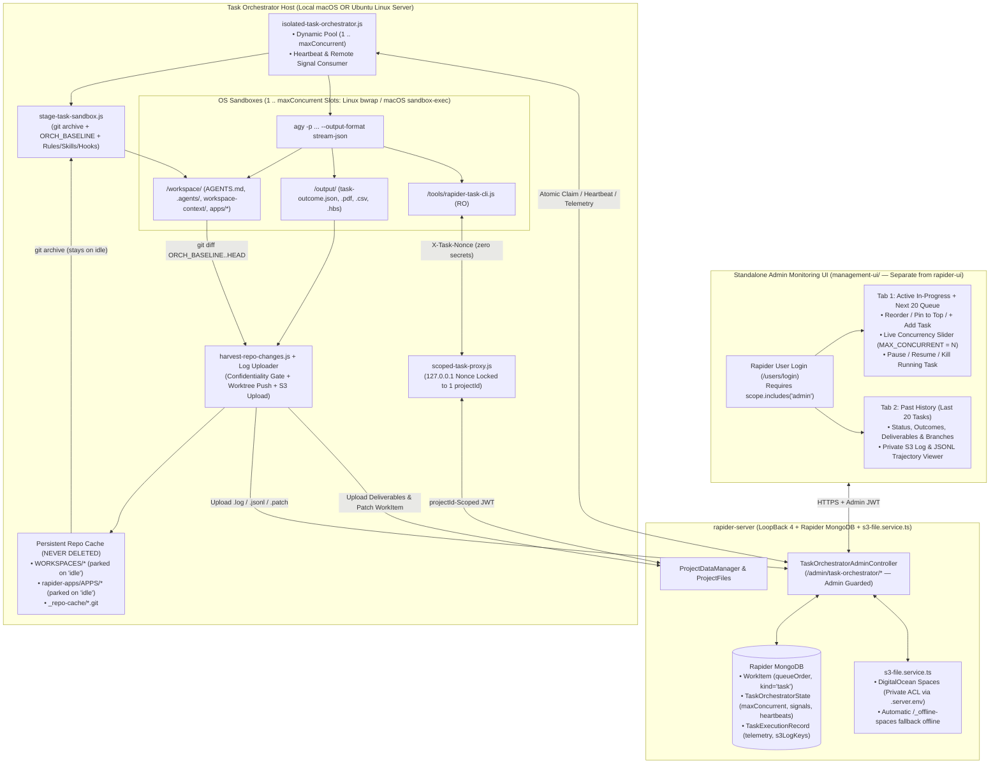

# Rapider Isolated Multi-Repo Task Orchestrator & Admin Monitoring Console — Unified Implementation Plan

> **Document Purpose:** Authoritative architecture and phased implementation plan combining:
> 1. **[agy_isolated_multi_repo_orchestrator_implementation_specification.md](./agy_isolated_multi_repo_orchestrator_implementation_specification.md)** (dynamic `N`-slot parallel `agy` pool, `git archive` + `ORCH_BASELINE` staging, rootless OS sandboxing, `stream-json` telemetry, host-side diff harvesting, and process-group lifecycle controls).
> 2. **Existing `rapider-task-worker` Implementation** (`WorkItem` `kind: "task"` ingestion, Step 2 Security & Workspace Scope Guardrail, Workspace metadata snapshots, orphan `idle` branch parking, Handlebars/CSV/PDF/API tools, `ProjectFile` artifact uploads, and outbound public-reply confidentiality gates).
> 3. **Rapider MongoDB + S3 (`s3-file.service.ts`) Native Persistence & Standalone Admin Monitoring UI** (dynamic live-configurable `maxConcurrent`, Rapider MongoDB metadata & queue reordering, DigitalOcean Spaces private S3 log storage, Admin-only Monitoring & Queue Control Web UI separate from `rapider-ui`, and seamless Local macOS <-> Ubuntu Linux execution).

---

## 1. Executive Summary & Core Architectural Decisions

### 1.1 Core System Guarantees
1. **Dynamic, Live-Configurable Concurrency (`maxConcurrent = 1..N`, Default `5`):**
   - `maxConcurrent` is stored dynamically in Rapider MongoDB (`TaskOrchestratorState.maxConcurrent`, seeded from `process.env.MAX_CONCURRENT || 5`) and can be increased or decreased **live at runtime** from the Admin Monitoring UI or CLI (`1`, `5`, `10`, `25`, etc.) **without restarting the worker daemon**.
   - Increasing `maxConcurrent` immediately claims additional tasks into newly opened slots; decreasing `maxConcurrent` lets active tasks finish gracefully while holding new claims until `activeCount < maxConcurrent`.
2. **Rapider MongoDB for All Metadata & Queue State + S3 (`s3-file.service.ts`) for Logs:**
   - **No separate primary SQLite database is introduced.** All task state, queue ordering (`queueOrder`), worker heartbeats, live log tails, and execution history are stored in **Rapider's existing MongoDB** (automatically using `rapider_offline` when `IS_OFFLINE_MODE=true` on local Mac).
   - Raw `agy` stream trajectories (`task_<id>.jsonl`), formatted step logs (`task_<id>.log`), and harvested git patches (`<repo>.patch`) are streamed locally only while a task is actively running, then uploaded via **`rapider-server`'s `s3-file.service.ts`** (`uploadFileBuffer` with `ACL: private`, controlled by `.server.env` DigitalOcean Spaces S3 config — and automatically falling back to `/_offline-spaces` in offline mode).
   - *(Note: A tiny local JSON retry spool file on the worker disk is used strictly as a transient network-blip buffer before flushing to Rapider MongoDB/S3 — zero separate SQLite infrastructure needed).*
3. **Zero Master Repo Deletion + 100% Physical Blindness to Other Repos:**
   - Master repositories (`WORKSPACES/*`, `rapider-apps/APPS/*`, and `_repo-cache/*.git`) **remain permanently on disk parked on their orphan `idle` branch and are never deleted**.
   - For each claimed task, `stage-task-sandbox.js` extracts **only** that Workspace's authorized repositories (`git archive <base_sha> | tar -x` -> single-commit `ORCH_BASELINE` local git repo with **zero remotes and zero other branches**) and runs `agy` inside an OS-level filesystem jail (**Ubuntu Linux**: rootless `bubblewrap` `bwrap`; **Local macOS**: Seatbelt `/usr/bin/sandbox-exec`).
4. **Standalone Admin-Only Monitoring & Queue Control Web UI (`rapider-task-worker/management-ui/`):**
   - Completely separate from `rapider-ui`, deployed/served independently, authenticating with **existing Rapider / Rapider UI user accounts** (`POST /users/login`).
   - **Strict `admin` Permission Gate:** Both the backend `/admin/task-orchestrator/*` API and the Monitoring UI require `scope.includes('admin')` (`PermissionScope.Admin`). Non-admin users receive `403 Forbidden`.
   - **Separated Tabs & Queue Controls:**
     - **Tab 1 (`Active & Queue`):** Shows all **currently in-progress tasks** (live `logTail`, worker slot, kill button) + the **next 20 queued tasks** with **Pin to Top**, **Drag-and-Drop / Up-Down Reordering**, and **`+ Add Task` (with "Add to Top of Queue" option)**.
     - **Tab 2 (`Past History`):** Shows the **last 20 completed/terminal tasks** (`resolved`, `pending`, `failed`, `rejected`, `killed`) with attached deliverables, pushed git branches, and an integrated **S3 Log & Trajectory Viewer**.
5. **Run & Improve Locally on macOS -> Deploy Identically to Ubuntu Linux:**
   - One unified Node.js 24 codebase in `rapider-task-worker` auto-detects `darwin` (`sandbox-exec`) vs `linux` (`bwrap`), letting you develop, debug rules/skills, and test full queue + UI flows on your MacBook (online or `IS_OFFLINE_MODE=true`) before deploying to an Ubuntu 22.04/24.04 LTS server via `systemd`.

---

## 2. Repository Isolation Deep-Dive: `idle`-Branch Cache + `git archive` + OS Sandbox

| Dimension | In-Place `idle`-Branch Switching Only (`manage-idle-branches.js`) | Clone & Delete Per Task | **Selected Hybrid: Persistent Master Cache Parked on `idle` + Per-Task `git archive` + OS Sandbox** |
| :--- | :--- | :--- | :--- |
| **Deletes master repos on disk?** | No | Yes (slow, high network I/O) | **No — NEVER deletes master repos.** Master clones stay permanently on disk parked on `idle`. |
| **Blind to other repos' code & git history?** | **No** — `.git/objects` in parked repos still holds `main` (`git -C ../other show main:...` leaks everything). | Yes | **100% Physically Blind** — `git archive` copies *only* working files of `base_branch` into `_sandboxes/task-<id>/workspace/<repo>` (`ORCH_BASELINE`, 0 remotes, 1 commit). |
| **Blind to sibling folders, `.env` & `rapider-server`?** | **No** — `ls ../..` reveals all 85 app folder names, other `projectId`s, and backend code. | Only with OS sandbox | **100% Physically Blind** — `bwrap` (Ubuntu) / `sandbox-exec` (macOS) blocks access to everything outside `_sandboxes/task-<id>/`. |
| **Supports Dynamic `maxConcurrent = 1..N`?** | **No** — concurrent tasks switching branches on shared folders corrupt each other. | Yes | **Yes — Lock-Free** — `git archive` reads packfiles in ~100ms **without switching the host repo off `idle`**, scaling cleanly to `5`, `10`, or `25+` concurrent tasks. |

---

## 3. End-to-End System Architecture



---

## 4. Rapider MongoDB Models, Queue Ordering & S3 Log Schema (`rapider-server`)

All persistence uses Rapider's primary MongoDB connection (`MongoDataSource` via `DatabaseResolver`) and `s3-file.service.ts`.

### 4.1 Queue Ordering & Priority Fields on `WorkItem` (`work-item.model.ts`)
Add explicit queue-ordering support to `WorkItem` (fully backward-compatible with existing Inbox items):
- **`queueOrder?: number`**:
  - On creation (`WorkItemController.create`), defaults to `occurredAt.getTime()` (e.g. `1794650000000`) so standard tasks preserve exact FIFO chronological ordering automatically.
  - **Pin to Top / Add to Top of Queue:** Queries the current minimum `queueOrder` among `status in ['open', 'queued']` (`kind: 'task'`) and sets `queueOrder = currentMinQueueOrder - 1000` (so it is guaranteed `#1` in line!).
  - **Manual Reordering (Drag-and-Drop / Move Up / Move Down / Set Rank):** Recomputes clean monotonic `queueOrder` values for the affected items in the queue.
- **Compound MongoDB Index on `WorkItem`:**
  - `{ kind: 1, status: 1, isDeleted: 1, queueOrder: 1, occurredAt: 1, createdDate: 1 }` — enables **single-query O(1) cross-workspace atomic task claiming** (`limit: freeSlots`) and instant **Next 20 Queue** rendering without looping across 40+ workspaces one by one!

### 4.2 New Model 1: `TaskOrchestratorState` (`src/models/task-orchestrator-state.model.ts`)
Stores global dynamic configuration, connected worker heartbeats, and remote UI-to-worker control signals in Rapider MongoDB (`id = 'global'`):
```ts
export class TaskOrchestratorState extends BaseEntity {
  id: string;                          // 'global'
  maxConcurrent: number;               // Default 5; dynamically adjustable 1..100 live from Admin UI
  paused: boolean;                     // Default false; when true, workers finish active tasks & claim 0 new
  hardPaused: boolean;                 // Default false; sends SIGSTOP to active sandbox PGIDs
  pollIntervalSeconds: number;         // Default 10
  sandboxRetentionCount: number;       // Default 20 (rolling local sandboxes retained on worker)
  pendingSignals: Array<{
    signalId: string;
    type: 'kill_task' | 'pause' | 'resume' | 'hard_pause';
    workItemId?: string;
    targetWorkerId?: string;
    requestedByUserId: string;
    requestedAt: string;
  }>;
  workers: Array<{
    workerId: string;                  // e.g. 'mac-local-dev' or 'ubuntu-prod-01'
    hostname: string;
    platform: 'darwin' | 'linux' | string;
    pid: number;
    status: 'online' | 'paused' | 'draining' | 'offline';
    activeSlotCount: number;
    activeWorkItemIds: string[];
    lastHeartbeatAt: string;
    startedAt: string;
  }>;
}
```

### 4.3 New Model 2: `TaskExecutionRecord` (`src/models/task-execution-record.model.ts`)
Stores detailed per-run execution telemetry, staged repository metadata, live `logTail`, and private S3 log keys in Rapider MongoDB (indexed by `{ workItemId: 1 }`, `{ status: 1, startedAt: -1 }`, `{ finishedAt: -1 }`):
```ts
export class TaskExecutionRecord extends BaseEntity {
  id: string;                          // UUID (runId)
  workItemId: string;                  // Foreign key -> WorkItem.id
  projectId: string;                   // Workspace Project ID
  workspaceName?: string;
  title: string;
  taskCategory?: string;               // 'data_report' | 'handlebars_template' | 'file_preparation' | 'api_action' | 'guardrail_rejected' | 'code_change'
  status: string;                      // 'staging' | 'running' | 'resolved' | 'pending' | 'failed' | 'rejected' | 'killed'
  workerId: string;
  workerPlatform: string;              // 'darwin' | 'linux'
  workerPid?: number;
  conversationId?: string;             // Captured from agy stream-json `init` event
  exitCode?: number;
  stagedRepos?: Array<{
    name: string;
    baseBranch: string;
    baseSha: string;
    targetBranch: string;
    pushed?: boolean;
  }>;
  pushedBranches?: Array<{ repo: string; branch: string }>;
  attachedFiles?: Array<{ id: string; name: string; mimeType: string; path: string }>;
  logTail?: string;                    // Last 40 formatted step lines updated live every ~4s during execution
  resultSummary?: string;
  s3TextLogKey?: string;               // Private S3 key: private/task-worker-logs/{workItemId}/{runId}.log
  s3JsonlLogKey?: string;              // Private S3 key: private/task-worker-logs/{workItemId}/{runId}.jsonl
  s3PatchKeys?: string[];              // Private S3 keys for any harvested git .patch files
  startedAt: Date;
  finishedAt?: Date;
  durationMs?: number;
}
```

### 4.4 S3 Log Upload & Retrieval via `s3-file.service.ts`
- **Bucket & Credentials:** Uses `rapider-server`'s existing `s3-file.service.ts` (`DO_SPACES_CONFIG` from `.server.env`: `SPACES_KEY`, `SPACES_SECRET`, `DO_SPACES_BUCKET`, `DO_SPACES_REGION`).
- **Strict Private ACL:** All worker logs and git patches are uploaded via `uploadFileBuffer(key, buffer, contentType, /* isPublic */ false)` using `buildStorageKey({ id: runId, folderType: 'private', type: 'task-worker-logs', parentEntityId: workItemId, filename, extension })`.
  - Logs are **never** public on CDN; they can **only** be read or downloaded via the Admin-guarded endpoint `GET /admin/task-orchestrator/tasks/{workItemId}/logs?format=log|jsonl|patch`, which streams `downloadFileBuffer(key)` (or returns a short-lived `getPrivateDownloadUrl(key, 300)`) after verifying `scope.includes('admin')`!
  - **Offline Mode Compatibility:** Because `uploadFileBuffer` and `downloadFileBuffer` in `s3-file.service.ts` already delegate to `offlineUploadFileBuffer` / `offlineDownloadFileBuffer` when `IS_OFFLINE_MODE=true`, the entire S3 log pipeline works **100% identically offline on your Mac**!

---

## 5. Admin Monitoring & Control API (`TaskOrchestratorAdminController`)

Implemented in `rapider-server/rappider/src/controllers/task-orchestrator-admin.controller.ts`.

### 5.1 Mandatory Admin Permission Guard
Every endpoint on `/admin/task-orchestrator/*` enforces:
```ts
private assertAdminScope(): void {
  const scopes: string[] = (this.authenticationTokenPayload?.scope as any) || [];
  const isAdmin =
    scopes.includes(PermissionScope.Admin) ||
    scopes.includes('admin') ||
    scopes.includes('Admin') ||
    scopes.includes('SuperAdmin');
  if (!isAdmin) {
    throw new HttpErrors.Forbidden('Admin permission is required to access Task Orchestrator Monitoring & Controls.');
  }
}
```

### 5.2 REST Endpoints Matrix

| Method & Endpoint | Consumer | Behavior |
| :--- | :--- | :--- |
| `GET /admin/task-orchestrator/me` | Monitor UI | Verifies JWT + `admin` scope; returns admin user profile + current `TaskOrchestratorState`. |
| `GET /admin/task-orchestrator/overview` | Monitor UI | Returns `{ state, activeTasks (all running), nextQueue (next 20 open/queued ordered by queueOrder ASC, occurredAt ASC), totalQueuedCount }`. |
| `GET /admin/task-orchestrator/history?limit=20` | Monitor UI (History Tab) | Returns **last 20** finished/paused tasks (`resolved`, `completed`, `pending`, `failed`, `rejected`, `killed`) ordered by `updatedDate DESC` enriched with `TaskExecutionRecord` (`durationMs`, `s3TextLogKey`, `s3JsonlLogKey`, `pushedBranches`). |
| `PATCH /admin/task-orchestrator/config` | Monitor UI / CLI | Updates `maxConcurrent` (`1..100`), `paused`, `hardPaused`, `pollIntervalSeconds`, or `sandboxRetentionCount` live in MongoDB. |
| `POST /admin/task-orchestrator/queue/tasks` | Monitor UI (`+ Add Task`) | Creates a `WorkItem` (`kind: 'task'`, `status: 'open'`) in the chosen `projectId`; if `pinToTop: true`, sets `queueOrder = minOpenQueueOrder - 1000`. |
| `PATCH /admin/task-orchestrator/queue/reorder` | Monitor UI | Reorders open queue items: supports `{ orderedWorkItemIds: string[] }` (drag-and-drop) and `{ workItemId, operation: 'pin_top' \| 'move_up' \| 'move_down' \| 'move_bottom' \| 'set_rank', rank?: number }`. |
| `POST /admin/task-orchestrator/tasks/{id}/control` | Monitor UI / CLI | Supports `kill` (appends `kill_task` to `pendingSignals` for active worker), `cancel` (marks queued item `cancelled`), `requeue_top` (sets failed/rejected/pending item back to `status: 'open'` at `#1` `queueOrder`). |
| `GET /admin/task-orchestrator/tasks/{id}/logs` | Monitor UI / CLI | Streams `.log` (human step log), `.jsonl` (raw `agy` events), or live `logTail` (if still running) from `TaskExecutionRecord` + `s3-file.service.ts`. |
| `POST /admin/task-orchestrator/worker/heartbeat` | Worker Daemon | Upserts worker node entry in `TaskOrchestratorState.workers`, returns `{ maxConcurrent, paused, hardPaused, signalsForWorker }` and acknowledges consumed signals. |
| `POST /admin/task-orchestrator/worker/claim` | Worker Daemon | Atomically claims up to `maxCount` (`<= maxConcurrent - activeSlots`) tasks across all Workspaces sorted by `queueOrder ASC, occurredAt ASC, createdDate ASC`, transitions `WorkItem.status = 'running'`, creates `TaskExecutionRecord`, and returns enriched task + Workspace context metadata. |
| `PATCH /admin/task-orchestrator/worker/runs/{runId}` | Worker Daemon | Streams live `logTail`, `conversationId`, `workerPid`, `stagedRepos`, and terminal status into `TaskExecutionRecord`. |
| `POST /admin/task-orchestrator/worker/runs/{runId}/logs` | Worker Daemon | Multipart/JSON upload of final `.log`, `.jsonl`, and `.patch` artifacts -> stored privately in S3 via `s3-file.service.ts` and linked on `TaskExecutionRecord`. |

---

## 6. Standalone Admin Monitoring & Control UI (`rapider-task-worker/management-ui/`)

A dedicated, standalone web application completely decoupled from `rapider-ui` (own `package.json`, dev server on port `4310`, static production build deployable anywhere or served cleanly via lightweight static server).

### 6.1 Authentication & Access Control Flow
1. **Sign-In Screen:**
   - Configurable API URL selector (defaults to `VITE_RAPIDER_API_URL` or `http://localhost:8081` on local dev / `https://dev.api.rappider.com` on cloud).
   - Authenticates using standard Rapider credentials (`POST /users/login` -> exchanges person token if needed -> calls `GET /admin/task-orchestrator/me`).
   - **Hard Admin Check:** If the user lacks `admin` scope, immediately clears the token and renders a clear **"Admin Access Required"** screen (`403`). Only verified Rapider Admins can view or control tasks.

### 6.2 Top Global Control Header
- **Worker Cluster Status Strip:** Shows active worker host(s) (`darwin` MacBook vs `linux` Ubuntu), PID, last heartbeat age (`2s ago`), and live slot occupancy bar (`Active Slots: 3 / 5`).
- **Live `MAX_CONCURRENT` Adjuster:** Stepper/input (`1` to `100`) with instant **Save** -> updates `maxConcurrent` in MongoDB so the worker scales slots immediately on its next heartbeat.
- **Orchestrator Controls:** `Pause Queue` / `Resume Queue` toggle, `Hard Pause Sandboxes`, and **`+ New Task`** button.

### 6.3 Separated Two-Tab Workspace

#### Tab 1: `Active & Queue` (In-Progress Tasks + Next 20 Up-Next Queue)
1. **Section A — Currently In-Progress (`Running` / `Staging`):**
   - Live cards for every active slot (`1..maxConcurrent`), polling every 3s:
   - Displays Workspace badge, `WorkItem` title, `agy` `conversationId`, staged repositories (`workspace-context`, `crm`, etc.), live elapsed timer, expandable dark-themed **Live Step Terminal (`logTail`)**, and a red **`Kill Task`** button.
2. **Section B — Next 20 Queued Tasks (`status: 'open' | 'queued'`, Limit 20):**
   - Displays `#1 .. #20` in exact execution order (`queueOrder ASC -> occurredAt ASC`), plus total queue depth badge (e.g., `Showing next 20 of 34 queued`).
   - **Interactive Queue Ordering Controls:**
     - **Drag-and-Drop Row Reordering** to place any task at any exact position in the top 20.
     - One-click **`⚡ Top (#1)`** button to jump a task straight to the front of the queue.
     - **`↑` / `↓` Step Buttons** & **`Cancel`** button.
   - **`+ New Task` Modal:** Pick target Workspace (`GET /projects`), enter Task Title & Instructions, optional priority, and **"Add directly to Top of Queue (#1)"** toggle.

#### Tab 2: `Past History` (Last 20 Completed / Terminal Tasks)
- Lists the **last 20 historical tasks** (`resolved`, `pending` awaiting user clarification, `failed`, `rejected`, `killed`):
- Shows Status badge, Workspace name, Title, Started/Finished timestamps, Duration (`42s`), Exit Code, Pushed Git Branches (`agy/task-...`), and clickable Deliverable chips.
- **Slide-Over Log & Diff Drawer:** Clicking any historical task opens a rich inspector fetching from S3 via `/admin/task-orchestrator/tasks/{id}/logs`:
  1. **Outcome & Public Reply Tab** (rendered Markdown + attached `ProjectFile` metadata)
  2. **Formatted Step Log Tab** (`task_<id>.log` from DigitalOcean Spaces S3)
  3. **Raw `agy` Stream JSONL Tab** (`task_<id>.jsonl` step-by-step tool calls & timing)
  4. **Git Patches Tab** (`<repo>.patch` diffs against `ORCH_BASELINE`, if any)
  5. **`Re-queue at Top (#1)` Button** (one-click retry for failed or updated tasks).

---

## 7. Worker Architecture: Isolation, Rules/Skills/Hooks & Mac-to-Ubuntu Parity

### 7.1 Directory Structure Inside `rapider-task-worker`
```text
rapider-task-worker/
├── AGENTS.md                                       # Host & Worker rules
├── package.json                                    # Orchestrator & CLI scripts
├── deploy/
│   ├── ubuntu-setup.sh                             # Ubuntu 22.04/24.04 provisioning (Node 24, bwrap, AppArmor, Chromium)
│   └── rapider-task-orchestrator.service           # Production systemd unit
├── management-ui/                                     # [NEW] Standalone Admin Monitoring & Queue Control Web App (port 4310)
│   ├── package.json
│   ├── index.html
│   └── src/                                        # Login (Admin guard), Active & Queue Tab (D&D + Top Pin), History Tab + S3 Log Viewer
├── scripts/
│   ├── isolated-task-orchestrator.js               # [NEW] Dynamic 1..maxConcurrent async pool + MongoDB heartbeat/signal loop
│   ├── stage-task-sandbox.js                       # [NEW] Non-destructive multi-repo git archive + ORCH_BASELINE + Rules/Skills/Hooks
│   ├── sandbox-runner.js                           # [NEW] OS Sandbox (Linux bwrap + macOS sandbox-exec) + stream-json reader
│   ├── scoped-task-proxy.js                        # [NEW] 127.0.0.1 Nonce Proxy locking agy to 1 projectId (zero .env secrets)
│   ├── harvest-repo-changes.js                     # [NEW] Binary diff ORCH_BASELINE..HEAD + host worktree push + S3 log upload
│   ├── rapider-task-ctl.js                         # [NEW] CLI controller (status | set-concurrency N | pause | resume | kill-task | logs)
│   ├── sandbox-tools/                              # [NEW] Read-only tools, compact AGENTS.md, .agents/skills/* & hooks.json
│   ├── manage-workspace-repos.js                   # [EXTEND] Installed microapp repo resolver + persistent cache parked on `idle`
│   ├── fetch-and-validate-tasks.js                 # [EXTEND] Uses /admin/task-orchestrator/worker/claim + fallback
│   ├── security-and-scope-guardrail.js             # [EXISTING] Step 2 pre-flight & Step 5 confidentiality gates
│   ├── workspace-tools-cli.js                      # [EXISTING] Paginated queries, Handlebars, CSV & PDF engines
│   ├── upload-task-artifacts.js                    # [EXISTING] Workspace ProjectFile uploader
│   └── patch-workitem-task.js                      # [EXISTING] WorkItem + WorkItemEvent + Recipient finalizer
├── WORKSPACES/                                     # Persistent Workspace cache (parked on `idle` — NEVER deleted)
├── _repo-cache/                                    # Persistent bare git mirrors (NEVER deleted)
├── _sandboxes/                                     # Per-task isolated sandboxes (rolling retention)
└── _process-logs/streams/                          # Ephemeral active run logs -> uploaded to S3 on completion & cleaned
```

### 7.2 Cross-Platform Sandbox & Execution Parity (Local Mac vs. Ubuntu Server)

| Capability | Local Mac Development (`process.platform === 'darwin'`) | Ubuntu Linux Server (`process.platform === 'linux'`) |
| :--- | :--- | :--- |
| **OS Sandbox Engine** | `/usr/bin/sandbox-exec -f sandbox.sb` (Seatbelt profile denying `_rapider-monorepo`, `WORKSPACES/`, `APPS/`, `~/.ssh`, `~/.aws`, `.env`; allowing only `_sandboxes/task-<id>/`). | `/usr/bin/bwrap` (`--unshare-all --share-net --die-with-parent --clearenv --tmpfs $HOME`, mounting only `/workspace`, `/output`, `/tools`). |
| **Master Repo Cache** | Uses existing `_rapider-monorepo/rapider-apps/APPS/*` & `WORKSPACES/*` (kept parked on `idle`). | Uses `/srv/rapider-worker/APPS/*`, `WORKSPACES/*`, and `_repo-cache/*.git` (kept parked on `idle`). |
| **Database & S3 Logs** | Connects to `localhost:8081` (online dev DB/Spaces **or** `IS_OFFLINE_MODE=true` local `rapider_offline` MongoDB + `/_offline-spaces`). | Connects over HTTPS to `RAPIDER_API_URL` (Rapider MongoDB + DigitalOcean Spaces private S3 via `s3-file.service.ts`). |
| **Process Management** | `npm run orchestrator` (or `npm run orchestrator:once`) + `management-ui` at `http://localhost:4310`. | `systemctl enable --now rapider-task-orchestrator` + `rapider-task-ctl` CLI + Admin Monitor UI. |

### 7.3 Guaranteed 4-Layer Agent Rules, Repo `.md` Discovery, Skills & Hooks Inside Every Sandbox
1. **Layer 1 — Root `/workspace/AGENTS.md` (`< 16 KB`, Always Auto-Loaded on Turn 1):** Concise non-negotiable sandbox rules, Step 2 scope guardrail, Mandatory Attachment Gate, `/output/task-outcome.json` contract, and the 6 Confidentiality Rules (staying safely under Antigravity's `24 KB` per-file cap).
2. **Layer 2 — Hierarchical Sub-Repo `AGENTS.md` + Auto-Generated Repo `.md` Docs Index:** Any `AGENTS.md` inside staged `/workspace/apps/<appKey>/` auto-loads when files in that repo are accessed; `stage-task-sandbox.js` also scans all mounted repos for `WORKSPACE_CONTEXT.md`, `README.md`, `rapider-sow.md`, and `docs/**/*.md` and injects a **Mounted Repo & Docs Index** into `/workspace/TASK_BRIEF.md`.
3. **Layer 3 — On-Demand Playbook Skills (`/workspace/.agents/skills/<name>/SKILL.md`):** Modular skills (`complex-data-reporting`, `handlebars-templating`, `deliverable-files`, `workspace-api-actions`) + auto-linked app skills (`.agents/skills.json`) for progressive disclosure without token bloat.
4. **Layer 4 — Unskippable Lifecycle Hooks (`/workspace/.agents/hooks.json`):** `SessionStart` hook injects mounted repo & attachment context; **`Stop` hook** verifies `/output/task-outcome.json`, attachment analysis, Handlebars compilation, and Public Reply Confidentiality *before* `agy` is allowed to exit (`decision: "continue"` on violation).

---

## 8. Phased Implementation Roadmap

### Phase 1 — Rapider MongoDB Models, Private S3 Log Service & Admin API (`rapider-server`)
1. Add `queueOrder?: number` + compound queue index to `WorkItem` (`src/models/work-item.model.ts`, `src/controllers/work-item.controller.ts`).
2. Create `TaskOrchestratorState` & `TaskExecutionRecord` models and repositories in `rapider-server/rappider/src/models/` & `src/repositories/`.
3. Create `TaskOrchestratorAdminController` (`src/controllers/task-orchestrator-admin.controller.ts`) enforcing `scope.includes('admin')`:
   - `me`, `overview` (active + next 20 queue), `history` (last 20), `config` (dynamic `maxConcurrent`), `queue/tasks` (`pinToTop`), `queue/reorder`, `tasks/{id}/control` (`kill`, `requeue_top`), `tasks/{id}/logs` (private S3 via `s3-file.service.ts`), and worker `heartbeat` / `claim` / `runs` endpoints.
4. Verify `npx lb-tsc` compiles cleanly with zero errors and add unit tests for `admin` scope rejection (`403`), `queueOrder` reordering/pin-to-top, dynamic `maxConcurrent` slot math, and S3 offline/online log storage.

### Phase 2 — Non-Destructive Multi-Repo Stager, Scoped Proxy & 4-Layer Rules/Skills/Hooks (`rapider-task-worker`)
1. Build `scripts/scoped-task-proxy.js` & `scripts/sandbox-tools/rapider-task-cli.js` (`127.0.0.1` ephemeral nonce proxy locked to `workItem.projectId`, zero `.env` in sandbox).
2. Author `scripts/sandbox-tools/SANDBOX_AGENTS.md` (`<16 KB`), `.agents/skills/*` playbooks, and `.agents/hooks/*` (`SessionStart` + `Stop` verifier).
3. Extend `scripts/manage-workspace-repos.js` & build `scripts/stage-task-sandbox.js` to stage Workspace context + installed microapp repos via `git archive` + `ORCH_BASELINE` while keeping all persistent host repos untouched on `idle`.

### Phase 3 — Cross-Platform OS Sandbox (`macOS` + `Ubuntu`), Diff Harvester & Dynamic `1..N` Orchestrator
1. Build `scripts/sandbox-runner.js` supporting **macOS `sandbox-exec`** and **Ubuntu `bwrap`** with dedicated `-PGID` process groups and real-time `stream-json` parsing.
2. Build `scripts/harvest-repo-changes.js` (binary diff `ORCH_BASELINE..HEAD` -> host `git worktree` branch push + upload `.log` / `.jsonl` / `.patch` to S3 via `/admin/task-orchestrator/worker/runs/{runId}/logs`).
3. Build `scripts/isolated-task-orchestrator.js` (dynamic `1..maxConcurrent` pool synced via MongoDB heartbeat, remote `kill_task` / `pause` / `resume` signal consumer, Confidentiality & Attachment Gates) + `scripts/rapider-task-ctl.js` CLI + `deploy/ubuntu-setup.sh` & `rapider-task-orchestrator.service`.

### Phase 4 — Standalone Admin Monitoring & Queue Control UI (`rapider-task-worker/management-ui/`)
1. Build standalone web app in `rapider-task-worker/management-ui/` (completely separate from `rapider-ui`, served on port `4310` via zero-dependency `management-ui/server.js` + bundled local Tailwind/FontAwesome vendor assets so it runs 100% offline on Mac with zero `npm install` network dependency and deploys cleanly on Ubuntu).
2. Implement Rapider `/users/login` + strict `admin` scope verification gate (`GET /admin/task-orchestrator/me`).
3. Build **Global Orchestrator Control Bar** (live worker nodes, slot gauge, live `MAX_CONCURRENT` adjuster, Pause/Resume, `+ New Task` with **Add to Top of Queue**).
4. Build **Tab 1: `Active & Queue`** (live In-Progress cards with streaming `logTail` & `Kill` button + Next 20 Queue table with Drag-and-Drop reordering, `Pin to Top (#1)`, `↑`/`↓`, and `Cancel`).
5. Build **Tab 2: `Past History`** (Last 20 finished tasks + slide-over S3 `.log` / `.jsonl` / `.patch` viewer + `Re-queue at Top (#1)`).

### Phase 5 — End-to-End Verification on Local Mac (Offline/Online) & Ubuntu Readiness
1. Automated test suite (`tests/isolated-orchestrator.test.js` + backend controller unit tests):
   - Verify non-admin user gets `403 Forbidden` on `/admin/task-orchestrator/*`.
   - Verify `Pin to Top` and Drag-and-Drop reordering change claim order deterministically.
   - Verify live `maxConcurrent` scaling (`5 -> 8 -> 2`) adjusts active worker slots dynamically without restart.
   - Verify macOS `sandbox-exec` (and `bwrap` command builder) blocks sibling repos, `.git` history, and `.env` while keeping master repos parked on `idle`.
   - Verify `.log` and `.jsonl` upload and stream back cleanly through `s3-file.service.ts`.
